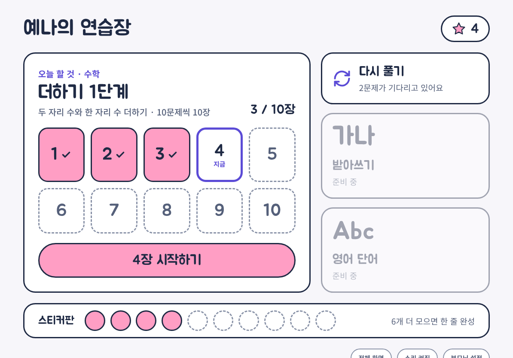
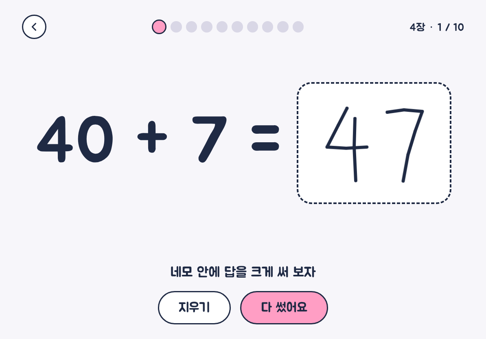
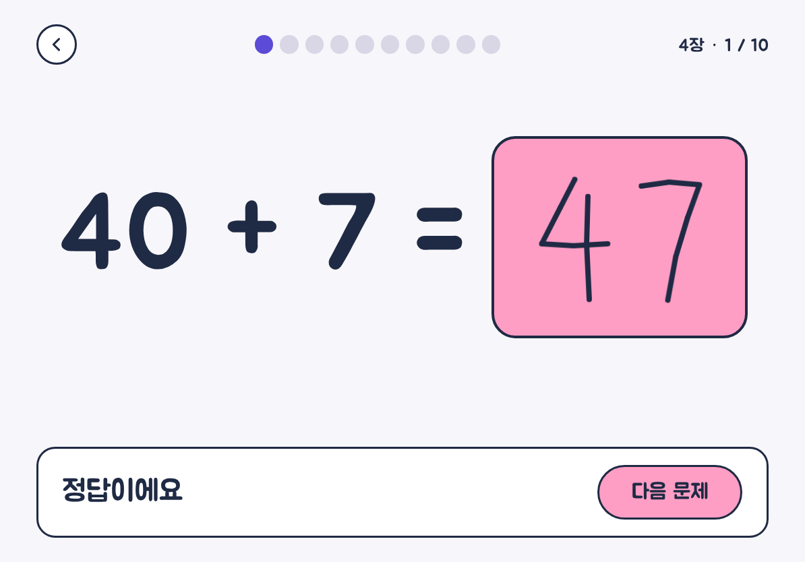
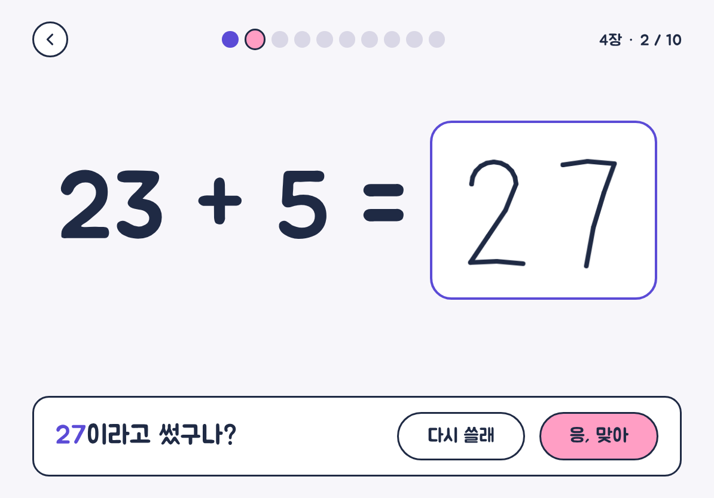
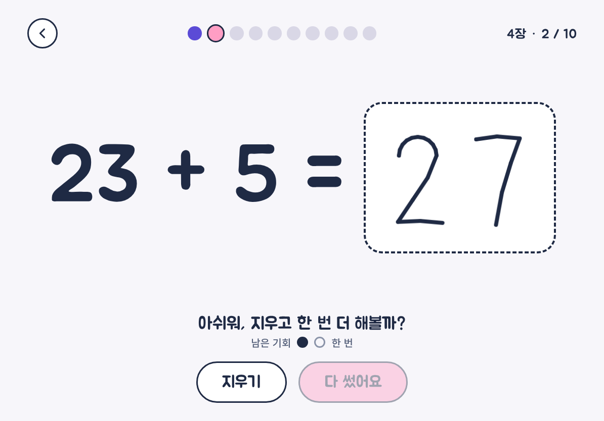
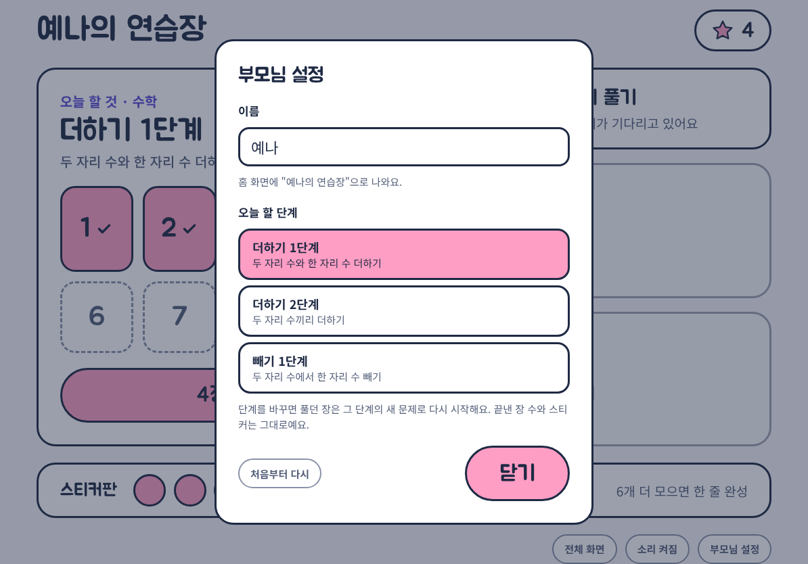

# kids-notebook

아이패드와 애플 펜슬로 쓰는 아이용 수학 연습장 웹 앱입니다. 답을 손으로 쓰면 앱이 숫자를 읽어 바로 채점합니다.

- 버전: 0.5
- 주소: https://hyo-minkang.github.io/kids-notebook/
- 설치 없이 Safari에서 열고, "홈 화면에 추가"를 하면 주소창 없이 앱처럼 열립니다.
- 서버가 없습니다. 인식과 채점은 모두 기기 안에서 하고, 기록도 기기에만 저장됩니다.

## 사용 화면

| 홈: 오늘 할 것 | 풀이: 칸에 답 쓰기 |
|---|---|
|  |  |

| 정답 | 정답과 다르게 읽혔을 때 |
|---|---|
|  |  |

| 한 번 틀렸을 때 | 부모님 설정 |
|---|---|
|  |  |

## 사용법

아이가 하는 것:

1. 홈에서 "○장 시작하기"를 누릅니다.
2. 문제를 보고 네모 칸에 답을 크게 씁니다. 잘못 쓰면 "지우기"를 누릅니다.
3. "다 썼어요"를 누릅니다. 맞으면 "정답이에요"가 나오고 "다음 문제"로 넘어갑니다.
4. 앱이 "27이라고 썼구나?" 하고 물으면, 그렇게 쓴 것이 맞을 때 "응, 맞아"를, 다르게 쓴 것이면 "다시 쓸래"를 누릅니다.
5. 틀리면 지우고 한 번 더 씁니다. 두 번 틀리면 정답을 보여 주고 다음 문제로 넘어갑니다.
6. 10문제를 다 풀면 스티커를 받습니다. 하루에 10장까지가 오늘 할 것입니다.

부모가 하는 것:

- 홈 오른쪽 아래 "부모님 설정"에서 이름과 오늘 할 단계를 바꿉니다.
- 두 번 틀린 문제는 다음 날 홈의 "다시 풀기"에 나오니, 아이가 눌러 다시 풀게 합니다.
- 소리는 홈 아래 "소리 켜짐/꺼짐" 버튼으로 켜고 끕니다.

## 기능

| 기능 | 내용 |
|---|---|
| 오늘 할 것 | 하루 100문제를 10문제씩 10장으로 나눔. 중간에 멈췄다가 이어서 할 수 있음 |
| 손글씨 채점 | 칸에 쓴 숫자를 읽어 채점. 정답이면 바로 넘어가고, 정답과 다르게 읽혔을 때만 "…라고 썼구나?"로 확인 |
| 두 번의 기회 | 한 번 틀리면 다시 쓸 수 있고, 두 번 틀리면 잠기고 정답을 보여 줌 |
| 다시 풀기 | 잠긴 문제는 다음 날 다시 나오고, 맞히면 3일 뒤, 7일 뒤에 한 번씩 더 나옴 |
| 스티커 | 한 장을 끝내면 1개, 전부 한 번에 맞히면 1개 더 |
| 선물 고르기 | 스티커 한 줄(10개)을 채우면 아이가 선물을 하나 고름. 고른 선물은 부모님 설정에 남고 "줬어요"로 지움 |
| 세로셈 | 십의 자리가 바뀌는 덧셈은 절반쯤을 세로셈으로 냄 |
| 단계 | 1~6단계(4 더하기부터 9 더하기까지)와 두 자리 수 더하기·빼기. JSON으로 추가 가능 |
| 부모님 설정 | 이름, 오늘 할 단계, 기록 지우기 |
| 효과음 | 정답, 확인, 틀림, 한 장 끝. 홈에서 켜고 끌 수 있음 |

## 아이패드에서 쓰기

1. 아이패드 Safari에서 위 주소를 엽니다.
2. 공유 버튼에서 "홈 화면에 추가"를 누릅니다.
3. 홈 화면 아이콘으로 엽니다.

아이가 다른 앱으로 나가지 않게 하려면 아이패드의 "사용법 유도" 기능을 함께 씁니다.

## 파일

| 파일 | 내용 |
|---|---|
| `index.html` | 완성본. 이 파일 하나로 동작한다 |
| `template.html` | 화면과 동작 코드. 고칠 때는 이 파일을 고친다 |
| `rec.js` | 필기 숫자 인식 (획 나누기, 28x28 변환, 모델 계산) |
| `weights.json` | 숫자 인식 모델 가중치 |
| `build.py` | `template.html` + `rec.js` + `weights.json` → `index.html` |
| `train.py` | 첫 모델(0.1~0.4)을 만든 학습 스크립트 |
| `train4.py`, `train2.py` | 지금 모델을 만든 학습 스크립트. MNIST에 프로그램으로 그린 각진 5와 9를 더해 학습한다. `train4.py`가 `train2.py`의 함수를 가져다 쓴다 |
| `handwriting-test.html` | 필기감과 인식률을 재는 테스트 페이지 |

## 고치고 올리기

`index.html`은 직접 고치지 않습니다. `template.html`을 고친 뒤 다시 만듭니다.

```bash
python3 build.py
git add .
git commit -m "변경 내용"
git push
```

`push` 하고 1~2분 뒤 GitHub Pages에 반영됩니다.

## 단계 추가

`template.html`의 `<script type="application/json" id="levelsData">` 안에 한 덩어리를 붙이고 `python3 build.py`를 실행합니다.

```json
{ "id": "add-3", "title": "더하기 3단계", "desc": "받아올림이 있는 더하기", "op": "+", "digits": [2, 1], "shuffle": true, "max": 100, "carry": "only" }
```

| 항목 | 뜻 |
|---|---|
| `id` | 단계 구분용 이름 (겹치면 안 됨) |
| `title`, `desc` | 화면에 보이는 이름과 설명 |
| `op` | `+` 또는 `-` |
| `digits` | 앞 수와 뒤 수의 자릿수. 예: `[2, 1]` |
| `range` | 자릿수 대신 범위로 정할 때. `[[앞 수 최소, 최대], [뒤 수 최소, 최대]]`. 예: 4 더하기는 `[[1, 15], [4, 4]]` |
| `shuffle` | `true`면 앞뒤 순서를 섞는다 |
| `max` | 더하기는 합의 상한, 빼기는 큰 수의 상한 |
| `carry` | 받아올림·받아내림: `any`, `none`(없는 것만), `only`(있는 것만) |
| `problems` | 규칙 대신 문제를 직접 적을 때. 예: `[[37, 5], [8, 46], [60, 4, "-"]]` |

오늘 할 단계는 홈의 "부모님 설정"에서 고릅니다.

## 선물 바꾸기

`template.html`의 `<script type="application/json" id="rewardsData">` 안의 목록을 고치고 `python3 build.py`를 실행합니다. `icon`은 `tv`, `play`, `store`, `gift`, `meal` 중에서 고릅니다.

```json
{ "id": "park", "label": "놀이터 가기", "icon": "gift" }
```

## 숫자 인식

- 쓴 획을 가로 위치로 묶어 숫자 하나씩으로 나눈 뒤, 각각을 28x28 그림으로 바꿔 작은 신경망(784-256-128-10)으로 읽습니다.
- 모델은 공개 손글씨 숫자 데이터(MNIST)로 학습했고, 그 시험용 묶음에서 98.7%를 맞혔습니다. 실제 아이 글씨에서는 더 낮을 수 있습니다.
- 숫자를 붙여 쓰거나 겹쳐 쓰면 한 글자로 읽습니다.
- 다시 학습하려면 MNIST 원본 파일 네 개가 있는 폴더를 주고 실행합니다: `python3 train.py <MNIST 폴더> weights.json ref.json`

## 기록 저장

오늘 진행, 스티커, 다시 풀 문제, 이름, 단계는 브라우저의 localStorage에 저장됩니다. 기기와 브라우저마다 따로이고, 브라우저 데이터를 지우면 사라집니다.

## 아직 없는 것

- 받아쓰기 (부모가 불러 주고 부모가 채점): 화면 시안만 있음
- 영어 단어: 보류

## 버전

| 버전 | 날짜 | 내용 |
|---|---|---|
| 0.5 | 2026-11-19 | 인식 모델을 다시 학습: 윗칸이 낮고 각진 5를 9로 읽던 문제 |
| 0.4 | 2026-11-19 | 숫자 나누기 수정: 7의 왼쪽 위 짧은 획처럼 따로 그은 작은 획을 옆 숫자에 붙여 읽음 (78을 178로 읽던 문제) |
| 0.3 | 2026-11-19 | 받아올림이 있는 덧셈을 무작위로 세로셈으로 출제. 스티커 한 줄을 채우면 선물 고르기 |
| 0.2 | 2026-11-19 | 단계를 4 더하기~9 더하기(1~6단계)로 구성. 풀이 화면이 스크롤되거나 밀리지 않게 고정 |
| 0.1 | 2026-11-17 | 첫 버전. 수학 풀이(더하기 1·2단계, 빼기 1단계), 손글씨 채점, 다시 풀기, 스티커, 부모님 설정, 효과음 |

버전 숫자는 `template.html`의 `APP_VERSION`에 있고, 앱의 "부모님 설정" 아래에 표시됩니다.
